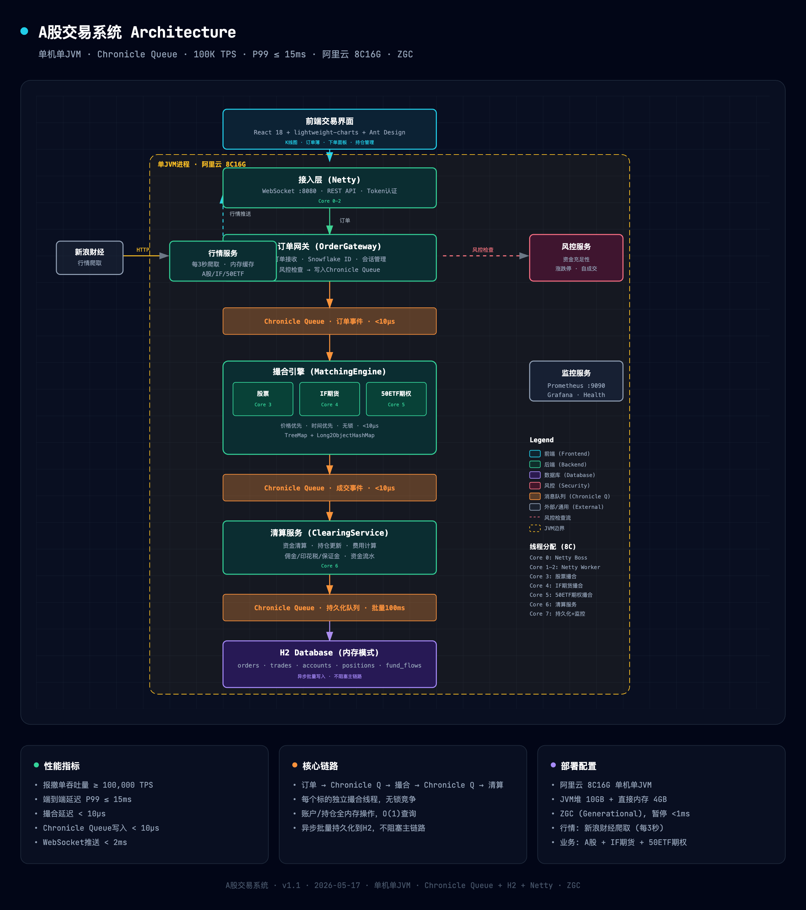
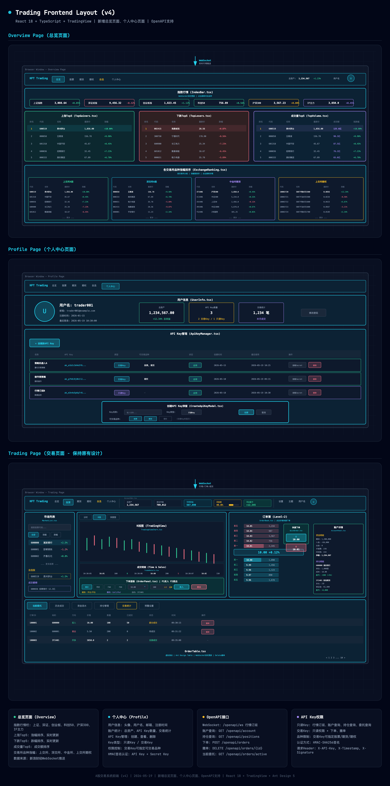

# HFT Trading System

A股模拟交易系统，单JVM部署，目标 100K TPS，P99延迟 <15ms。

## 系统特性

- **高性能**：基于 Chronicle Queue 的低延迟事件驱动架构
- **强一致性**：单线程内存操作，保证账户/持仓数据强一致
- **RPO = 0**：快照 + 增量恢复机制，重启后数据零丢失
- **内部撮合**：支持用户间撮合（含做市商策略用户）
- **实时推送**：WebSocket 实时行情、订单、成交、账户变动推送

## 项目结构

```
hft/
├── docs/                           # 文档目录
│   ├── technical-solution-V12.md   # 技术方案V12（最新版）
│   ├── AgentProgram.md             # Agent 实施方案
│   ├── agents-architecture.md      # Agent 架构设计
│   ├── http-api-definition.html    # HTTP API 定义
│   ├── trading-full-pipeline-v9.html  # 交易全链路图
│   ├── frontend-layout.html        # 前端布局设计
│   ├── admin-layout.html           # 管理端布局设计
│   └── test-plan.md                # 测试计划
├── src/main/java/com/hft/trading/
│   ├── agent/                      # Agent 监控模块
│   │   ├── AgentContext.java       # Agent 上下文
│   │   ├── ConsistencyAuditAgent.java   # 一致性审计 Agent
│   │   └── OperationsDiagnosticAgent.java # 运维诊断 Agent
│   ├── worker/                     # Worker 处理器
│   │   ├── AccountWorker.java      # 账户操作处理
│   │   ├── MatchingEngineWorker.java # 撮合引擎
│   │   └── ClearingWorker.java     # 清算处理
│   ├── lifecycle/                  # 生命周期管理
│   ├── queue/                      # Chronicle Queue 封装
│   ├── store/                      # 内存存储
│   ├── websocket/                  # WebSocket 服务
│   └── ...
├── frontend/                       # 前端 React 应用
├── CLAUDE.md                       # 项目说明（给 AI 助手）
└── README.md                       # 本文件
```

## 技术栈

| 类别 | 技术 |
|------|------|
| Java | Java 21 LTS |
| 框架 | Spring Boot 3.x + 虚拟线程 |
| 消息队列 | Chronicle Queue |
| 快照存储 | Chronicle Map |
| 数据库 | H2 (磁盘模式，历史查询) |
| GC | ZGC (Generational) |
| 前端 | React 18 + TypeScript + Vite |
| 图表 | lightweight-charts (TradingView) |
| UI | Ant Design 5.x |
| 状态管理 | Zustand |
| 监控 | Prometheus + Grafana |
| 日志 | ELK Stack |
| 链路追踪 | Jaeger |

## 架构图

### 系统架构


### 前端布局


## 快速开始

### 前端构建
```bash
cd frontend
npm install
npm run build
cp -r dist/* ../src/main/resources/static/
```

### 后端构建
```bash
mvn clean package -DskipTests
java -Xms10g -Xmx10g -XX:+UseZGC -jar target/hft-trading.jar
```

### 访问地址

| 资源 | 地址 |
|------|------|
| 前端页面 | http://host:port/ |
| REST API | http://host:port/api/* |
| WebSocket | ws://host:port/ws |
| OpenAPI | http://host:port/openapi/* |
| 健康检查 | http://host:port/actuator/health |

## 核心文档

- [技术方案 V12](docs/technical-solution-V12.md) - 完整技术方案（最新版）
- [Agent 实施方案](docs/AgentProgram.md) - 一致性审计 & 运维诊断 Agent
- [Agent 架构设计](docs/agents-architecture.md) - Agent 系统架构
- [HTTP API 定义](docs/http-api-definition.html) - REST API 和 WebSocket 接口
- [交易全链路图](docs/trading-full-pipeline-v9.html) - 下单到清结算完整流程
- [前端布局](docs/frontend-layout.html) - 前端组件设计
- [管理端布局](docs/admin-layout.html) - 管理端组件设计
- [测试计划](docs/test-plan.md) - 测试策略与用例

## Agent 监控模块

系统内置两个 Agent 进行实时监控和告警：

| Agent | 功能 | 运行周期 |
|-------|------|---------|
| ConsistencyAuditAgent | 账户/持仓不变式验证、冻结-订单一致性、CQ压力监控 | 30秒 |
| OperationsDiagnosticAgent | Worker延迟统计(P50/P90/P99)、CQ堆积趋势、GC指标 | 30秒 |

Agent 告警通过 WebSocket `agent_alert` 频道推送到管理端，支持 P0/P1/P2 三级告警。

## 开发进度

- [x] 核心交易链路（下单、撤单、撮合、清算）
- [x] 内存存储 + Chronicle Queue 持久化
- [x] 快照恢复机制（RPO=0）
- [x] WebSocket 实时推送
- [x] 前端交易面板
- [x] 管理端界面
- [x] Agent 监控模块
- [ ] 性能测试
- [ ] 生产部署

## 许可证

MIT License
